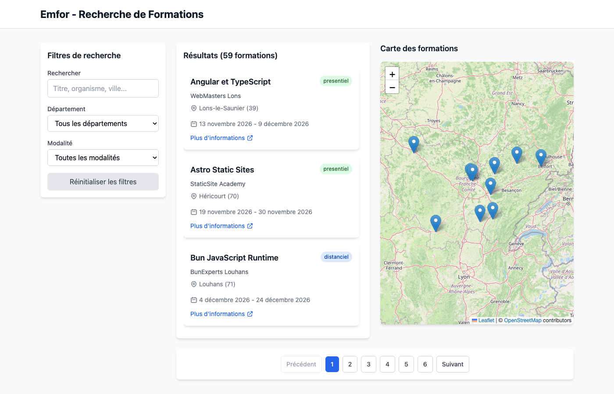

# Formation Search Portal

A proof of concept for searching training courses on a map: a Symfony REST API and a React + Leaflet frontend.



The user interface and the demo data are in French (the project targets the Bourgogne-Franche-Comté region).

## Features

These were checked against a running instance (see [Verification](#verification)):

- Full-text search on title, training provider and city, debounced by 400 ms
- Filters by département and by delivery mode (in person, remote, hybrid), combinable with the search
- Paginated results (10 per page)
- Leaflet map with one marker per result on the current page; the map zooms to fit them
- A popup with course details when you click a marker
- OpenAPI documentation served at `/api/docs`

## Architecture

```
api/        Symfony 7.1 REST API (PHP 8.3, Doctrine ORM, NelmioApiDoc, NelmioCors)
frontend/   React 18 + TypeScript + Vite 8, TanStack Query, Tailwind CSS 4, React Leaflet
docker/     Caddy configuration (PHP-FPM front for the API, static server for the build)
```

API endpoints:

| Method | Path | Description |
|--------|------|-------------|
| GET | `/health` | Health check |
| GET | `/formations?q=&departement=&modalite=&page=&limit=` | Paginated, filtered list |
| GET | `/formations/{id}` | One course by UUID (404 if unknown) |

Two ways to run it, with different databases:

- **Local scripts** (`start.sh`): PHP built-in server and SQLite file in `api/var/data.db`.
- **Docker Compose**: MySQL 8, PHP-FPM behind Caddy, Vite dev server.

## Try it

### With Docker

Requirements: Docker with Compose v2.

```bash
git clone https://github.com/FredBourouliou/formation-search-portal.git
cd formation-search-portal
docker compose up -d --build
```

On first start the API container runs the migrations and loads the demo data. Then open:

- Frontend: http://localhost:5173
- API: http://localhost:8080 (docs at http://localhost:8080/api/docs)

Stop with `docker compose down` (add `-v` to delete the database volume).

### Without Docker

Requirements: PHP 8.3+ with `pdo_sqlite`, Node.js 20.19+ or 22.12+, and [Composer](https://getcomposer.org/download/).
If `composer` is not on your `PATH`, `start.sh` downloads `composer.phar` into the repository root (it is git-ignored).

```bash
git clone https://github.com/FredBourouliou/formation-search-portal.git
cd formation-search-portal
./start.sh    # installs dependencies, creates the SQLite database, starts both servers
./status.sh   # shows what is running
./stop.sh     # stops everything
```

The script messages are in French.

## Configuration

`api/.env` holds non-secret development defaults, following the Symfony convention. Put local overrides in `api/.env.local` (git-ignored) or in real environment variables. `docker-compose.yml` overrides `DATABASE_URL` to use its MySQL service; the credentials in that file are placeholders for local use only.

The frontend reads `VITE_API_BASE_URL` (default `http://localhost:8080`).

## Tests

The API has 8 functional PHPUnit tests (health check, pagination, each filter, 404). They need a MySQL database:

```bash
make test-api          # with the Docker Compose stack running
```

The frontend has no automated tests; `npm run build` type-checks it with `tsc`.

GitHub Actions runs three jobs on every push: API tests against a MySQL service, frontend build, and Docker image builds.

## Verification

Last checked locally with the Docker Compose stack and a headless Chromium (Playwright): 59 results on load, search `Dijon` returns 4, filter `hybride` returns 20, département `25` returns 8 with 8 markers, the marker popup opens, page 2 loads, and the browser console shows no errors.

## Demo data

The 59 courses loaded by the fixtures (`api/src/DataFixtures/FormationFixtures.php`) are fictional. Provider names are invented, coordinates are city centres in the eight départements of Bourgogne-Franche-Comté, dates are generated relative to the load date, and "more information" links point to `example.com`.

## License

[MIT](LICENSE)
